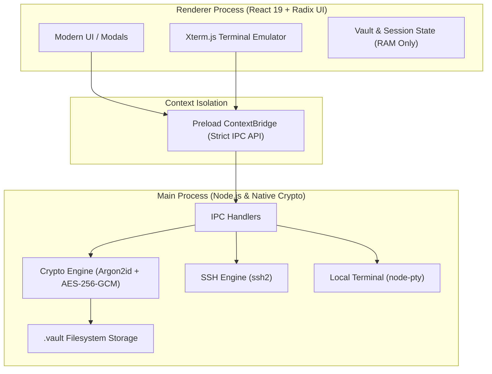

# 🚀 Architecture & Technical Design

This document details the internal architecture, security engineering, and cryptographic design of **RellySSH**.

---

## 🏛️ High-Level System Architecture

RellySSH is built on top of **Electron**, **React 19**, **Vite**, and **TypeScript**, enforcing strict process separation and cryptographic safety.

---

## 🔐 Cryptographic Vault Architecture

Unlike traditional tools that either store plaintext credentials or lock you into proprietary remote cloud accounts, RellySSH uses **local, zero-knowledge, encrypted `.vault` files**.

### Comparison: Vault Format V1 vs V2

| Parameter | V1 (Legacy) | V2 (Current Specification) |
| :--- | :--- | :--- |
| **Cipher** | AES-256-GCM | AES-256-GCM |
| **KDF Algorithm** | PBKDF2-SHA512 | **Argon2id** (RFC 9106) |
| **Memory Hardness** | None (CPU bound) | **64 MiB – 256 MiB** (Anti-ASIC / GPU) |
| **Iterations** | 250,000 | Tuned per security profile (3 to 25) |
| **Key Hierarchy** | Direct Key derivation | **Two-Tier (KEK + DEK Architecture)** |
| **Format Structure** | Flat JSON envelope | Typed envelope with full KDF metadata |

---

## 🛡️ Two-Tier Key Architecture (V2)

In V2 vaults, RellySSH utilizes a **Key Encryption Key (KEK)** and a random **Data Encryption Key (DEK)**:

1. **Master Password**: Provided by user during unlock.
2. **KEK (Key Encryption Key)**:
   $$\text{KEK} = \text{Argon2id}(\text{Password}, \text{Salt}, \text{Memory}, \text{Iterations}, \text{Parallelism})$$
3. **DEK (Data Encryption Key)**: 256-bit cryptographically secure random bytes generated via `crypto.randomBytes(32)`.
4. **Wrapped DEK**: The DEK is encrypted with the KEK using `AES-256-GCM`.
5. **Payload Ciphertext**: All credentials, host configurations, and SSH private keys are serialized to JSON and encrypted with the DEK using `AES-256-GCM`.

### Why this architecture?
- **Instant Password Changes**: You can rotate your master passphrase without re-encrypting massive payloads or rewriting the whole credential database. Only the DEK wrapping is re-computed.
- **Quantum & Hardware-Resistance**: Argon2id protects against GPU and ASIC cracking clusters.
- **Integrity Guarantee**: AES-256-GCM provides authenticated encryption with an authentication tag (`authTag`). Any data tampering triggers immediate rejection.

---

## ⚙️ Security Profiles

Users can choose from multiple Argon2id security profiles depending on their workstation hardware:

| Profile | Memory (`m`) | Iterations (`t`) | Parallelism (`p`) | Target Latency | Security Level |
| :--- | :--- | :--- | :--- | :--- | :--- |
| **Standard** | 64 MiB | 3 | 4 | ~1 - 2s | Recommended baseline (RFC 9106) |
| **Strong** | 128 MiB | 10 | 4 | ~3 - 5s | High resistance against state-level clusters |
| **Maximum** | 256 MiB | 25 | 4 | ~10s | Ultra-paranoid brute-force prevention |

---

## 🔄 Zero-Loss Automatic Migration (V1 ➔ V2)

When an existing V1 `.vault` is unlocked:
1. **Identification**: Format detection checks for V1 signature (`PBKDF2` iteration metadata).
2. **Safe Decryption**: Decrypts payload using PBKDF2-SHA512.
3. **Safe Re-encryption**: Generates a fresh random DEK and derives KEK with Argon2id.
4. **Atomic Write Pipeline**:
   - Creates a temporary file (`.vault.tmp`).
   - Verifies the integrity by decrypting the temp file in memory.
   - Creates a fallback backup (`.vault.backup`).
   - Atomically replaces the original file.
   - Original data is never endangered if a crash or power failure occurs.

---

## 🔒 Security Best Practices for Users

1. **Portable Sync**: You can sync your `.vault` file across devices via Git, Syncthing, Nextcloud, or Dropbox. Without your master password, attackers cannot brute-force the Argon2id container.
2. **Memory Safety**: Decrypted keys and credentials reside in RAM only while the vault is unlocked, and are cleared on lock or application termination.
3. **Zero Telemetry**: RellySSH will never include background trackers, telemetry, analytics, or automated crash reporting to third-party endpoints.
